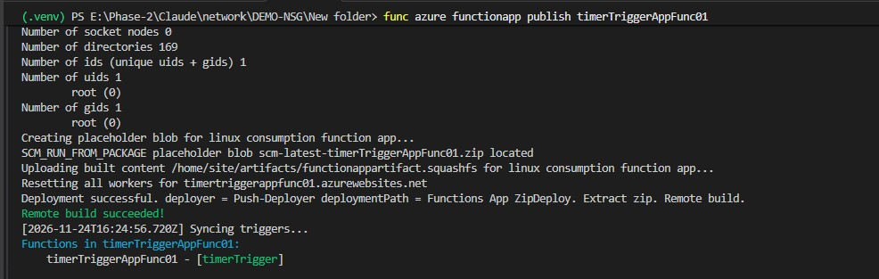
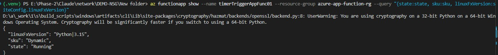

# Azure Functions (Python) — Timer Trigger Deployment & Troubleshooting

A serverless **Python Timer Trigger** deployed on **Microsoft Azure Functions** (Linux Consumption Plan), configured via Azure CLI and Azure Functions Core Tools. This repository includes both the function implementation and a documented troubleshooting guide resolving Windows PowerShell CLI parsing quirks, Python version mismatches, and Kudu (`503 Site Unavailable`) deployment errors.

---

## Architecture & Tech Stack

* **Cloud Provider:** Microsoft Azure (`eastus2`)
* **Compute:** Azure Functions (Linux, Python `3.11` runtime)
* **Storage:** Azure Storage Account (`Standard_LRS`, StorageV2)
* **Trigger:** CRON Timer Trigger (`*/5 * * * * *` — executes every 5 seconds)
* **Tooling:** Azure CLI (`az`), Azure Functions Core Tools (`func` v4), PowerShell, Oryx Remote Build

---

## Project Structure

```text
├── function_app.py        # Python v2 programming model timer trigger logic
├── host.json              # Function host configuration & logging settings
├── requirements.txt       # Python dependencies installed via Oryx remote build
├── local.settings.json    # Local development environment variables (gitignored)
└── .funcignore            # Excludes local virtual environments (.venv) from deployment
```

---

## Deployment Workflow

### 1. Initialize Local Project & Timer Trigger
```powershell
func init --python
func new --name timerTriggerAppFunc01 --template "Timer trigger" --schedule "*/5 * * * * *"
```

### 2. Provision Azure Infrastructure
```powershell
# Create Resource Group
az group create --name azure-app-function-rg --location eastus2

# Create Backing Storage Account
az storage account create `
  --name appafuncstorageacc `
  --location eastus2 `
  --resource-group azure-app-function-rg `
  --sku Standard_LRS

# Create Linux Consumption Function App
az functionapp create `
  --resource-group azure-app-function-rg `
  --consumption-plan-location eastus2 `
  --runtime python `
  --runtime-version 3.11 `
  --functions-version 4 `
  --name timerTriggerAppFunc01 `
  --storage-account appafuncstorageacc `
  --os-type Linux
```

### 3. Configure Runtime & Publish via Remote Build
```powershell
# Set Linux Python runtime using PowerShell stop-parsing token (--%)
az functionapp config set --% --name timerTriggerAppFunc01 --resource-group azure-app-function-rg --linux-fx-version "Python|3.11"

# Ensure worker runtime is explicitly set
az functionapp config appsettings set --name timerTriggerAppFunc01 --resource-group azure-app-function-rg --settings FUNCTIONS_WORKER_RUNTIME=python

# Restart Function App and deploy with Oryx remote build
az functionapp restart --name timerTriggerAppFunc01 --resource-group azure-app-function-rg
func azure functionapp publish timerTriggerAppFunc01 --build remote
```

### 4. Verify Live Execution
```powershell
func azure functionapp logstream timerTriggerAppFunc01
```
### Build Succeed using CLI :


---

## Troubleshooting & Root Cause Analysis

During initial deployment from a Windows PowerShell environment, three distinct issues were diagnosed and resolved:

### Issue 1: PowerShell Pipe Parsing Error (`'3.11' is not recognized...`)
* **Symptom:** Running `az functionapp config set ... --linux-fx-version "Python|3.11"` failed with `'3.11' is not recognized as an internal or external command`.
* **Root Cause:** When PowerShell invokes external batch executables (`az.cmd`), `cmd.exe` strips outer double quotes and interprets the pipe character (`|`) inside `"Python|3.11"` as a command pipeline operator.
* **Resolution:** Used PowerShell's stop-parsing token (`--%`) before arguments so the literal `"Python|3.11"` string passes directly to the Azure CLI without shell interpretation.




---

### Issue 2: `Response status code does not indicate success: 503 (Site Unavailable)`
* **Symptom:** `func azure functionapp publish` failed with HTTP `503` even though `az functionapp show --query "state"` reported `"Running"`.
* **Root Cause:** Immediately following provisioning or runtime configuration updates, the background Kudu/SCM deployment container (`*.scm.azurewebsites.net`) was still initializing, and `FUNCTIONS_WORKER_RUNTIME` / `linuxFxVersion` had not yet been applied cleanly across worker instances.
* **Resolution:**
  1. Verified network accessibility (`defaultAction: "Allow"` on Storage Account and open SCM IP restrictions).
  2. Explicitly configured `FUNCTIONS_WORKER_RUNTIME=python` and `linuxFxVersion="Python|3.11"`.
  3. Issued `az functionapp restart` and allowed ~30 seconds for the Kudu/SCM endpoint to stabilize before re-publishing.


---

### Issue 3: Local Python (`3.15.2`) vs. Azure Runtime (`3.11`) Mismatch
* **Symptom:** Core Tools flagged a local Python `3.15.2` environment warning during deployment.
* **Root Cause:** Azure Functions supports Python `3.9`–`3.13`; packaging local binaries compiled against `3.15.2` risks `ModuleNotFoundError` in production.
* **Resolution:** Leveraged **Microsoft Oryx remote build** (`oryx build ... --platform python --platform-version 3.11`), compiling and packaging all `requirements.txt` dependencies directly inside Azure's Linux Python 3.11 container.


