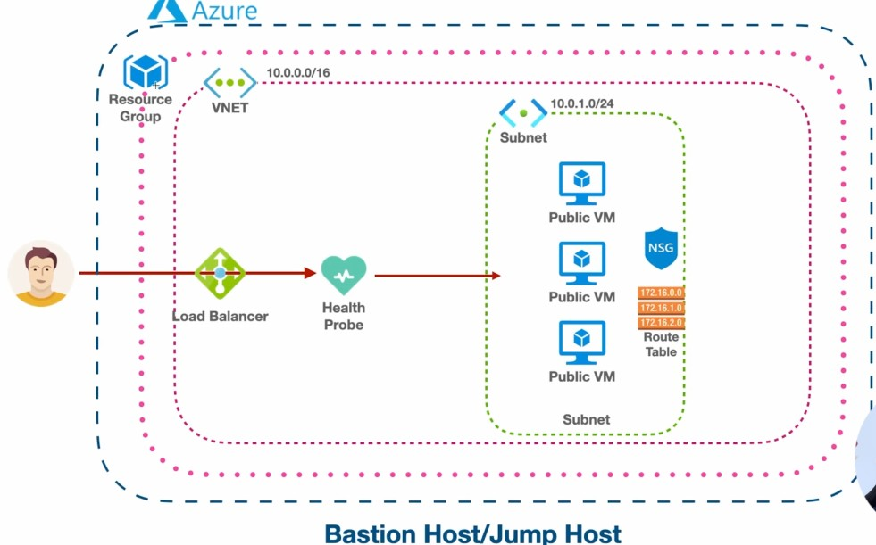
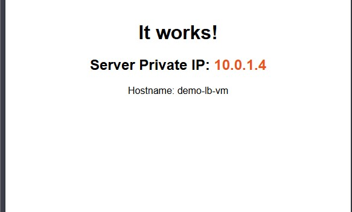
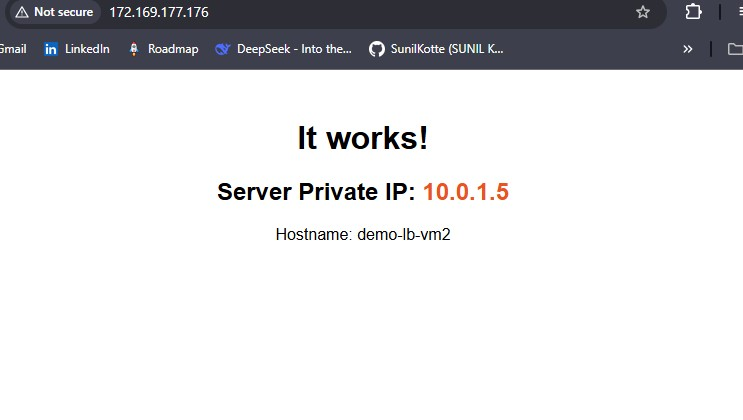
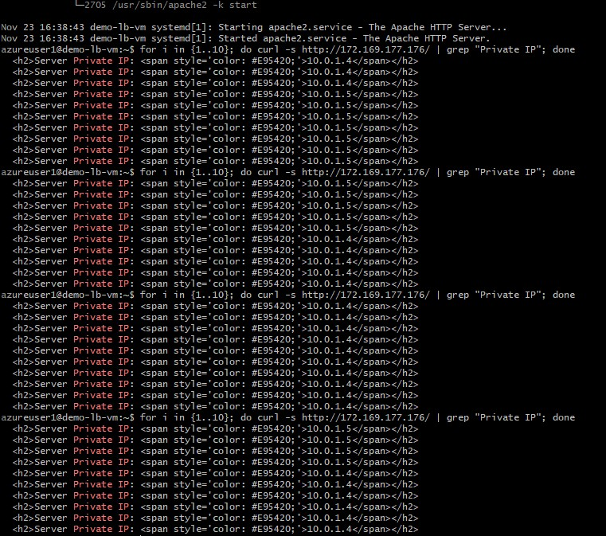

# High-Availability Web Architecture with Azure Load Balancer

Deployed a highly available, fault-tolerant web infrastructure on Microsoft Azure using a Standard Load Balancer to distribute incoming HTTP traffic across multiple backend Linux Virtual Machines.

## Architecture Overview

```text
                    [ Internet Traffic (HTTP :80) ]
                                  │
                                  ▼
                 ┌─────────────────────────────────┐
                 │  Azure Load Balancer (Standard) │
                 │       Public Frontend IP        │
                 └────────────────┬────────────────┘
                                  │
                     ┌────────────┴────────────┐
                     ▼                         ▼
          ┌─────────────────────┐   ┌─────────────────────┐
          │   Backend VM 01     │   │   Backend VM 02     │
          │  (Apache / Nginx)   │   │  (Apache / Nginx)   │
          └─────────────────────┘   └─────────────────────┘
                     ▲                         ▲
                     └────────────┬────────────┘
                                  │
                  [ Health Probe (HTTP / TCP :80) ]
```

* **Virtual Network (VNet) & Subnets:** Isolated private network housing the backend compute tier.
* **Frontend IP Configuration:** Static Standard Public IP serving as the single entry point for client requests.
* **Backend Pool:** Two Linux VMs running web servers with distinct host identifiers to verify round-robin routing.
* **Health Probes:** Configured HTTP/TCP probes on port `80` (5-second interval) to automatically remove unhealthy instances from rotation.
* **Load Balancing Rules:** Mapped frontend port `80` to backend port `80` with session persistence disabled to demonstrate active traffic distribution.
* **Network Security Groups (NSGs):** Restricted inbound traffic to only allow HTTP (`80`) from the Load Balancer/Internet and SSH (`22`) for administrative access.

---

## Implementation Steps

1. **Network & Compute Provisioning**
   * Created a dedicated Resource Group, Virtual Network (`10.0.0.0/16`), and Subnet (`10.0.1.0/24`).
   * Provisioned two Ubuntu Virtual Machines (`demo-lb-vm` and `demo-lb-vm2`) locked down behind an NSG and bootstrapped Apache/Nginx via Custom Data to serve custom host-specific HTML pages.

2. **Load Balancer Configuration**
   * Deployed a **Standard SKU Public Load Balancer** and attached a static Public IP address.
   * Created a **Backend Pool** and registered the private NICs of both Virtual Machines.

3. **Health Monitoring & Routing Rules**
   * Configured a **Health Probe** monitoring port `80` to verify instance availability.
   * Defined a **Load Balancing Rule** routing `Frontend:80 -> BackendPool:80` tied to the health probe.

4. **Validation & Failover Testing**
   * Verified traffic distribution by repeatedly hitting the Load Balancer's Public IP and confirming responses alternated between `demo-lb-vm` and `demo-lb-vm2`:
     ```bash
     for i in {1..4}; do curl -s http://<LB_PUBLIC_IP>; done
     ```
   * Simulated a node outage by stopping the web service on `vm-web-01` (`sudo systemctl stop apache2`) and verified zero downtime as the health probe automatically routed 100% of traffic to `vm-web-02`.

---

## Proof of Work
* **High-Availability Web Architecture with Azure Load Balancer**  
  

* **Backend Pool & Health Status:**  
  
  
* **Load Balancing in Action:**  
  

---

## Key Takeaways & Troubleshooting

* **Standard vs. Basic SKU Security:** Standard Load Balancers are secure by default and require explicit Network Security Group (NSG) rules on the backend subnet/NICs to permit probe and application traffic.
* **Outbound Connectivity:** VMs behind a Standard Load Balancer without instance-level public IPs require explicit outbound rules or a NAT Gateway for package updates (`apt update`).