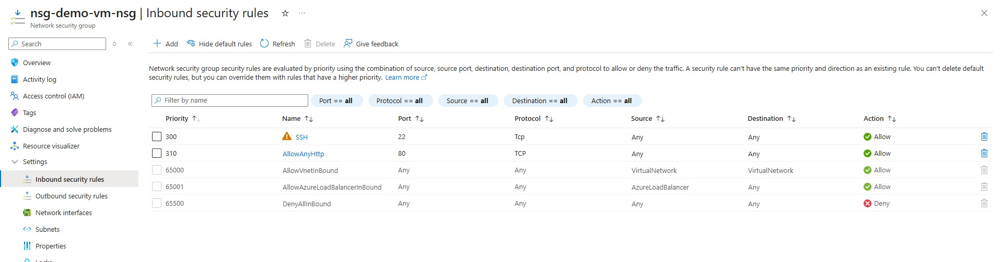
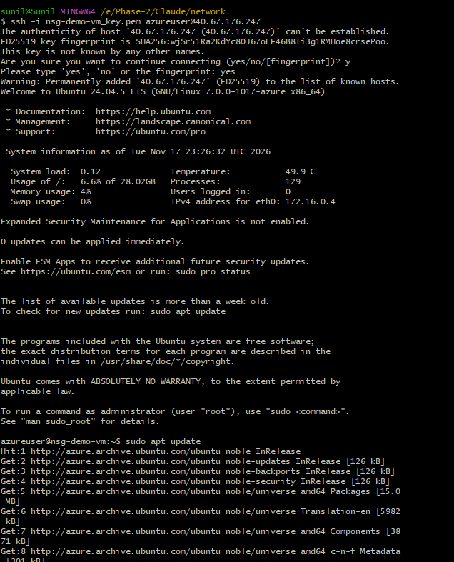
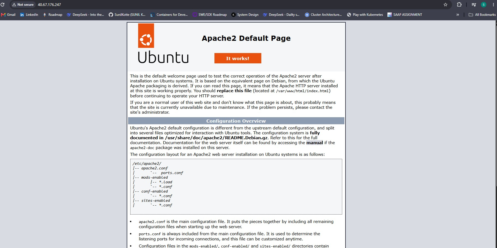

# Securing & Deploying a Web Server on Microsoft Azure using Network Security Groups (NSGs)

## 📌 Project Overview
In this hands-on cloud infrastructure project, I provisioned a Linux Virtual Machine in Microsoft Azure, configured stateful firewall rules using **Network Security Groups (NSGs)**, established a secure administrative connection via **SSH**, and deployed an **Apache HTTP web server** accessible over the public internet.

This lab demonstrates foundational cloud networking, SSH key-pair management, traffic troubleshooting, and implementing the **Principle of Least Privilege (PoLP)** at the network interface level.

---

## 🏗️ Architecture & Traffic Flow

```text
[ Local Machine (SSH Client) ] ──── Port 22 (TCP) ────┐
                                                      ▼
                                            [ Azure NSG Firewall ] ──▶ [ Ubuntu VM (Apache2) ]
                                                      ▲
[ Public Internet (Browser)  ] ──── Port 80 (TCP) ────┘
```

1. **Virtual Network & Compute:** Provisioned an Ubuntu Linux VM inside an Azure Virtual Network (VNet) with a Public IP address.
2. **Default Security Posture:** Verified that Azure’s default NSG rules block unsolicited inbound internet traffic (`DenyAllInBound`) to protect the instance.
3. **Secure Remote Access (SSH):** Configured an inbound security rule for **Port 22 (TCP)** and connected remotely from a local terminal using SSH key-pair authentication.
4. **Web Server Deployment:** Installed and started the Apache2 web server via the Linux CLI.
5. **Public Traffic Enablement (HTTP):** Configured an additional inbound NSG rule for **Port 80 (TCP)** to expose the web application to external HTTP requests while keeping all other ports locked down.

---

## 🛠️ Step-by-Step Implementation

### 1. Provisioning & Initial NSG Configuration (Port 22)
By default, Azure NSGs deny all inbound traffic from the internet (`DenyAllInBound`). To administer the server securely:
* Navigated to the VM's **Networking / Network Security Group** settings in the Azure Portal.
* Created an **Inbound Security Rule** for SSH:
  * **Source:** `Any` *(or restricted to local IP)*
  * **Source Port Ranges:** `*`
  * **Destination:** `Any`
  * **Destination Port Ranges:** `22`
  * **Protocol:** `TCP`
  * **Action:** `Allow`
  * **Priority:** `300`

Connected from my local machine via terminal using SSH key-pair authentication:
```bash
ssh -i /path/to/private-key.pem azureuser@<PUBLIC_IP_ADDRESS>
```

### 2. Installing & Verifying Apache2 Web Server
Once authenticated into the Ubuntu VM, I updated the package index and installed Apache2:
```bash
sudo apt update
sudo apt install apache2 -y
sudo systemctl status apache2
```
* **Observation & Troubleshooting:** Attempting to reach `http://<PUBLIC_IP_ADDRESS>` from a local browser timed out at this stage—confirming that the NSG was actively dropping unpermitted HTTP traffic despite the `apache2` service running locally on the VM.

### 3. Configuring Inbound HTTP Rule (Port 80)
To allow public web traffic without exposing unnecessary administrative ports:
* Added a second **Inbound Security Rule** to the NSG:
  * **Source:** `Any`
  * **Source Port Ranges:** `*`
  * **Destination:** `Any`
  * **Destination Port Ranges:** `80`
  * **Protocol:** `TCP`
  * **Action:** `Allow`
  * **Priority:** `310` *(assigned a higher priority / lower numerical value than the default deny rule)*

### 4. End-to-End Validation
Refreshed `http://<PUBLIC_IP_ADDRESS>` in the browser and verified that the **Apache2 Ubuntu Default Page** loaded successfully.

---

## 📋 Final NSG Inbound Rules Summary

| Priority | Name | Port | Protocol | Source | Destination | Action |
| :--- | :--- | :--- | :--- | :--- | :--- | :--- |
| `300` | `Allow-SSH` | `22` | TCP | Any | Any | **Allow** |
| `310` | `Allow-HTTP` | `80` | TCP | Any | Any | **Allow** |
| `65500` | `DenyAllInBound` *(Default)* | `*` | Any | Any | Any | **Deny** |

---

## 🔐 Key Security Takeaways & Production Hardening
* **Principle of Least Privilege (PoLP):** Only exposed the exact ports required for the workload (`22` for management, `80` for web traffic), leaving all other ports closed by default.
* **Stateful Firewall Behavior:** Observed how Azure NSGs automatically allow return outbound response traffic for established inbound sessions without needing separate outbound rules.
* **Production Hardening (Next Steps):**
  * Restrict Port `22` (`SSH`) strictly to a known corporate IP/VPN or replace public SSH exposure entirely with **Azure Bastion**.
  * Enforce **HTTPS (`Port 443`)** with SSL/TLS certificates and redirect unencrypted HTTP traffic.
  * Automate VM and NSG rule deployments using **ARM Templates** or **Terraform**.

---

## 📸 Screenshots

* **NSG Inbound Rules**
  


* **SSH Terminal Connection**
  


* **Apache Live Page**
  